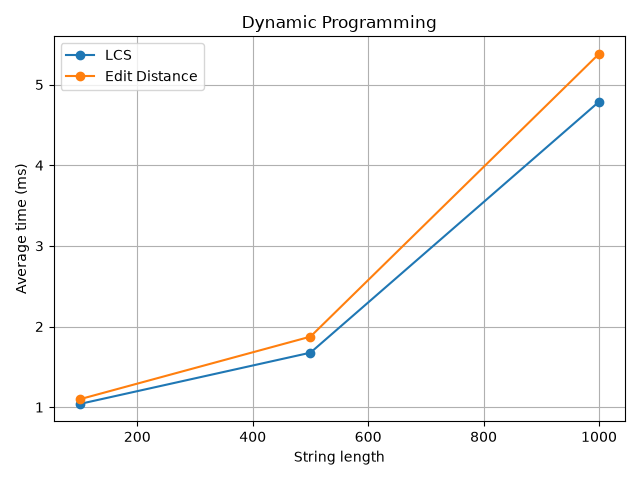
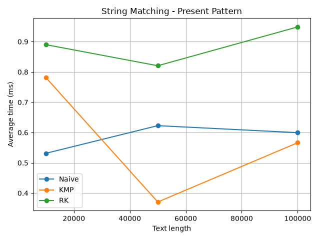

# Assignment 4 - Text Analysis Algorithms

## 1. Project Description

In this assignment, I implemented six text analysis algorithms in Java and compared their performance.

The algorithms are:

- Longest Common Subsequence (LCS)
- Edit Distance
- Naive String Matching
- Knuth-Morris-Pratt (KMP)
- Rabin-Karp
- Kasai's Algorithm

I implemented the algorithms without using built-in algorithm implementations. I also added tests, measured execution times, counted character comparisons, and created graphs.

## 2. Project Structure

```text
daa-ass4/
├── src/
│   ├── Lcs.java
│   ├── Edit.java
│   ├── Naive.java
│   ├── Kmp.java
│   ├── Rk.java
│   ├── Kasai.java
│   ├── Tests.java
│   └── Bench.java
├── results/
│   ├── dp.csv
│   ├── match.csv
│   ├── kasai.csv
│   ├── dp.png
│   └── match.png
├── plots.py
└── README.md
```

## 3. Algorithms

### LCS

LCS finds the length of the longest common subsequence of two strings. The characters do not have to be next to each other.

I used a two-dimensional DP table.

If the characters match:

`dp[i][j] = dp[i-1][j-1] + 1`

Otherwise:

`dp[i][j] = max(dp[i-1][j], dp[i][j-1])`

The first row and column are initialized with zeros.

This works because matching characters extend the previous subsequence. If the characters are different, we take the better result after skipping one character.

### Edit Distance

Edit Distance finds the minimum number of operations needed to change one string into another.

The allowed operations are insertion, deletion, and substitution.

If the characters match:

`dp[i][j] = dp[i-1][j-1]`

Otherwise:

`dp[i][j] = 1 + min(dp[i-1][j], dp[i][j-1], dp[i-1][j-1])`

The first row and column are initialized with their indices.

The algorithm considers the three possible operations and chooses the one with the minimum cost.

### Naive String Matching

Naive checks the pattern at every possible position in the text.

It compares characters one by one. When a mismatch happens, it moves to the next position.

It is simple to implement, but it can repeat many comparisons.

### KMP

KMP uses the LPS (Longest Prefix Suffix) array.

LPS stores the length of the longest proper prefix that is also a suffix for each part of the pattern.

When a mismatch happens, KMP uses LPS to continue searching without starting the comparison again from the beginning.

This avoids repeated comparisons and gives O(n+m) time complexity.

### Rabin-Karp

Rabin-Karp uses hashing to search for a pattern.

It calculates the pattern hash and the hash of each text window.

A rolling hash is used to calculate the next window hash efficiently.

If the hashes match, the algorithm checks the characters directly because different strings can have the same hash.

I used base 256 and modulus 1000000007.

### Kasai

Kasai builds the LCP (Longest Common Prefix) array using an existing suffix array.

LCP shows the length of the common prefix between two neighboring suffixes in sorted order.

For example, for `banana`:

Suffix array: `[5, 3, 1, 0, 4, 2]`

LCP array: `[0, 1, 3, 0, 0, 2]`

The first LCP value is zero because there is no previous suffix.

Kasai uses a rank array and reuses the previous matching length to work in O(n) time.

## 4. Implementation Details

I used Java 17 and standard Java libraries.

Main assumptions:

- All indices start from 0.
- Matching algorithms return all occurrences, including overlapping ones.
- An empty pattern matches at positions from 0 to `n`.
- If the pattern is longer than the text, the result is empty.
- LCS and Edit Distance use full DP tables.
- Rabin-Karp checks characters when hashes match to handle collisions.
- Kasai receives a valid suffix array.
- Suffix array construction is not included in Kasai's measured execution time.

## 5. Complexity Analysis

Here, `n` is the text or first string length, and `m` is the pattern or second string length.

| Algorithm | Main operation | Best time | Worst time | Extra space |
|---|---|---|---|---|
| LCS | DP recurrence | O(nm) | O(nm) | O(nm) |
| Edit Distance | DP recurrence | O(nm) | O(nm) | O(nm) |
| Naive | Character comparisons | O(n) | O(nm) | O(1) |
| KMP | LPS and matching | O(n+m) | O(n+m) | O(m) |
| Rabin-Karp | Rolling hash | O(n+m) expected | O(nm) | O(1) |
| Kasai | LCP comparisons | O(n) | O(n) | O(n) |

LCS and Edit Distance fill a DP table with `(n+1) × (m+1)` cells. Each cell takes constant time, so both algorithms use O(nm) time and space.

Naive checks up to `n-m+1` positions and may compare `m` characters at each position. This gives O(nm) worst-case time. It can be faster when mismatches happen early.

KMP builds LPS in O(m) and searches in O(n). It uses O(m) extra memory for the LPS array.

Rabin-Karp calculates rolling hashes in constant time per window after preprocessing. Its expected time is O(n+m), but many hash collisions can cause O(nm) time because the algorithm verifies matching hashes.

Kasai builds the rank array and calculates LCP values in O(n) time. It uses O(n) extra memory.

The space complexities for matching exclude the returned list of occurrence indices.

## 6. Testing

I created `Tests.java` to check all algorithms.

For LCS, I tested identical strings, different strings, empty strings, and a normal subsequence example.

For Edit Distance, I tested identical strings, empty strings, insertion, deletion, and substitution.

For string matching, I tested:

- Pattern at the beginning, middle, and end
- Multiple occurrences
- Overlapping occurrences
- Pattern not found
- Pattern longer than the text
- Empty pattern and empty text

Naive, KMP, and Rabin-Karp were checked against the same expected occurrence indices.

For Kasai, I tested `banana` with its known suffix array and LCP array. I also tested empty, single-character, and repeated-character strings.

I also ran 1000 random matching cases.

**Test result:**

```text
Passed: 1000 random matching cases
All 53 tests passed

Process finished with exit code 0
```

All implemented tests passed.

## 7. Experimental Setup

I used `Bench.java` for performance experiments.

Settings:

- Java 17
- Random seed: 42
- Alphabet: `abcd`
- 5 timed runs per experiment
- Average execution time in milliseconds
- Timing with `System.nanoTime()`

Input generation, console output, and file operations are excluded from the timed regions.

The same inputs are used when comparing algorithms solving the same problem.

For string matching, the pattern length is 20 characters. The present pattern is taken from the middle of the text. The absent pattern contains only `z`, which does not appear in the generated alphabet.

For Kasai, the suffix array is prepared before timing.

### Input Sizes

| Experiment | Input sizes |
|---|---|
| LCS | 100, 500, 1000 |
| Edit Distance | 100, 500, 1000 |
| String Matching | 10000, 50000, 100000 |
| Kasai | 1000, 5000, 10000 |

## 8. Experimental Results

All times are in milliseconds.

### LCS and Edit Distance

| Size | LCS | Edit Distance |
|---|---:|---:|
| 100 | 1.03938 | 1.09762 |
| 500 | 1.67564 | 1.87450 |
| 1000 | 4.78736 | 5.38104 |



Both algorithms became slower with larger strings. Edit Distance was slightly slower than LCS in these experiments.

### String Matching - Present Pattern

| Text length | Naive | KMP | Rabin-Karp |
|---|---:|---:|---:|
| 10000 | 0.53142 | 0.78142 | 0.89014 |
| 50000 | 0.62274 | 0.37068 | 0.82054 |
| 100000 | 0.59964 | 0.56650 | 0.94680 |



Naive was fast on the smaller input. KMP performed better on the larger inputs in these measurements.

Rabin-Karp was slower because it also calculates and updates hashes.

### String Matching - Absent Pattern

| Text length | Naive | KMP | Rabin-Karp |
|---|---:|---:|---:|
| 10000 | 0.23162 | 0.22598 | 0.30492 |
| 50000 | 0.10558 | 0.30308 | 0.88112 |
| 100000 | 0.23152 | 0.17928 | 0.86518 |

Naive performed well because the first character of the absent pattern does not appear in the text.

### Character Comparisons

Comparison counts for present patterns:

| Text length | Naive | KMP | Rabin-Karp |
|---|---:|---:|---:|
| 10000 | 13353 | 12471 | 20 |
| 50000 | 66551 | 61668 | 20 |
| 100000 | 133474 | 125047 | 20 |

KMP used fewer character comparisons than Naive.

Rabin-Karp only compares characters directly after a hash match, so its recorded comparison count was much smaller.

These counters measure different operations. KMP includes LPS comparisons, while Rabin-Karp counts direct character verification after matching hashes.

### Kasai

| Size | Time (ms) |
|---|---:|
| 1000 | 0.17472 |
| 5000 | 0.42824 |
| 10000 | 0.40280 |

Kasai worked quickly for all tested sizes.

The time for 10000 characters was slightly lower than for 5000. This can happen because of JVM optimization and measurement noise.

## 9. Discussion

The experimental results generally agree with the theoretical complexity.

LCS and Edit Distance take more time for larger inputs because their DP tables become larger.

Naive is simple and can be fast when mismatches happen early. However, it has O(nm) worst-case complexity.

KMP avoids repeated comparisons using LPS and guarantees O(n+m) time.

Rabin-Karp uses rolling hashes, but hash calculations also require time. It was not the fastest in my experiments.

Kasai has O(n) time complexity when the suffix array is already available.

Measured times do not always grow smoothly because of JVM optimization, CPU load, and other system processes.

Theoretical complexity shows how the amount of work grows, while experimental time shows how long the implementation takes on a particular system.

## 10. How to Run

Requirements:

- Java 17 or newer
- Python 3
- matplotlib

Open a terminal in the project folder.

Compile Java files:

```bash
javac -d out src/*.java
```

Run tests:

```bash
java -cp out Tests
```

Run experiments:

```bash
java -cp out Bench
```

The experiments generate CSV files in the `results` folder.

Install matplotlib if needed:

```bash
py -m pip install matplotlib
```

Generate graphs:

```bash
py plots.py
```

The graphs are saved as `results/dp.png` and `results/match.png`.

## 11. Conclusion

In this assignment, I implemented six algorithms and compared their complexity and performance.

LCS and Edit Distance use dynamic programming and require O(nm) time and space.

Naive is simple but can be slow in the worst case.

KMP uses the LPS array and guarantees linear matching time.

Rabin-Karp uses rolling hashes and has good expected performance, but hash collisions can make it slower.

Kasai builds the LCP array in O(n) time when the suffix array is provided.

The experiments showed that theoretical complexity is important, but actual execution time also depends on the input and the system.
